# 星光播放器用户手册

> 适用于星光播放器 1.0。最后更新：2026-10-16。

星光播放器是一款离线经咒、佛号与歌曲播放器，内置 21 首音频，无需登录，也不需要联网下载音频。它的两个核心功能是：为每首曲目设置重复遍数，以及让多台设备按同一时间基准同步播放。

本手册中的界面图片均来自真实 iOS Simulator 或 Android Emulator。青绿色边框圈出要查看或操作的区域，箭头连接控件与图内中文说明。系统界面的语言、按钮位置和可见控制项可能随系统版本、设备品牌与可用空间变化。

## 目录

1. [开始之前](#1-开始之前)
2. [三个主要页面](#2-三个主要页面)
3. [快速开始](#3-快速开始)
4. [播放页的五个按钮](#4-播放页的五个按钮)
5. [四种播放模式与重复遍数](#5-四种播放模式与重复遍数)
6. [当前遍数如何显示](#6-当前遍数如何显示)
7. [遍数保存与清零](#7-遍数保存与清零)
8. [同步播放详解](#8-同步播放详解)
9. [关怀模式](#9-关怀模式)
10. [横屏、方屏和 iPad](#10-横屏方屏和-ipad)
11. [后台、通知与锁屏播放](#11-后台通知与锁屏播放)
12. [导出诊断信息](#12-导出诊断信息)
13. [常见问题](#13-常见问题)
14. [隐私](#14-隐私)

## 1. 开始之前

首次安装的默认设置是：

- 播放模式：单曲循环；
- 同步播放：开启；
- 每首重复遍数：1 遍；
- 关怀模式：关闭，显示完整的普通界面。

最左侧的模式图标表示当前为“单曲循环”：

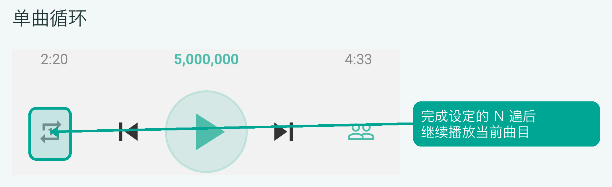

最右侧的绿色双人图标表示同步播放已开启：

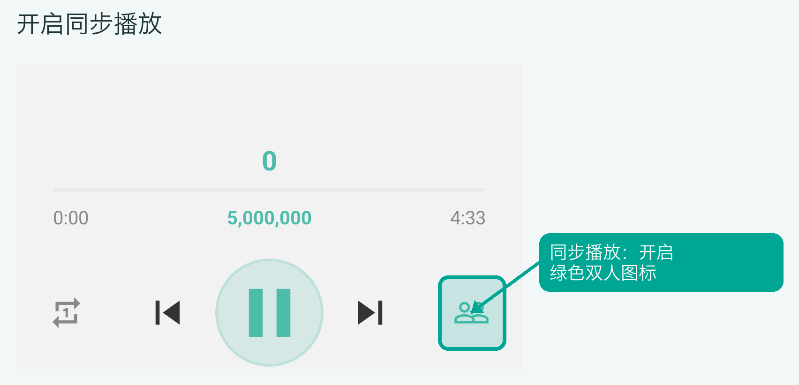

“我的”页中快捷值 `1` 高亮，表示每首重复 1 遍：

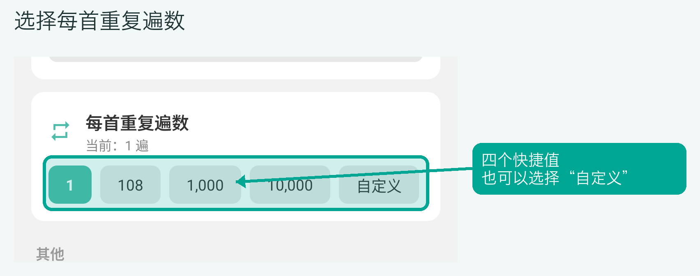

按钮显示“切换到关怀模式”，说明当前处于普通模式：

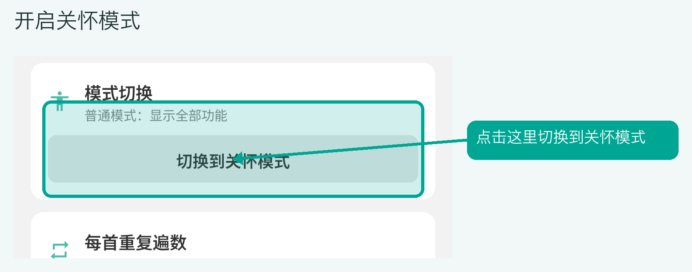

如果只想让一首曲目每次都从头开始，请先在“播放”页关闭同步播放，再到“列表”重新选择曲目。同步播放开启时，曲目可能从中间开始，这是设计行为，不是音频缺失。

版本兼容说明：Android 版最低支持 Android 6.0。iOS 工程仍以 iOS/iPadOS 13.4 为源码兼容目标，但当前已生成并上传的 `1.0.0 (4)` 安装包实测最低系统为 iOS/iPadOS 15.0；在重新构建并核验新的安装包前，应以 App Store 显示的兼容要求为准，不能将 build 4 宣传为支持 iOS 13/14。

## 2. 三个主要页面

普通模式底部有“播放”“列表”“我的”三个入口：

| 页面 | 用途                                                         |
| ---- | ------------------------------------------------------------ |
| 播放 | 播放、暂停、切歌、切换播放模式或同步模式，查看进度与遍数     |
| 列表 | 从 21 首内置曲目中选曲；点击后会立即播放，并创建新的播放任务 |
| 我的 | 切换关怀模式、设置每首重复遍数、导出诊断信息                 |

在“列表”中点击曲目后，青绿色行表示当前已选曲目，行末图标表示正在播放：

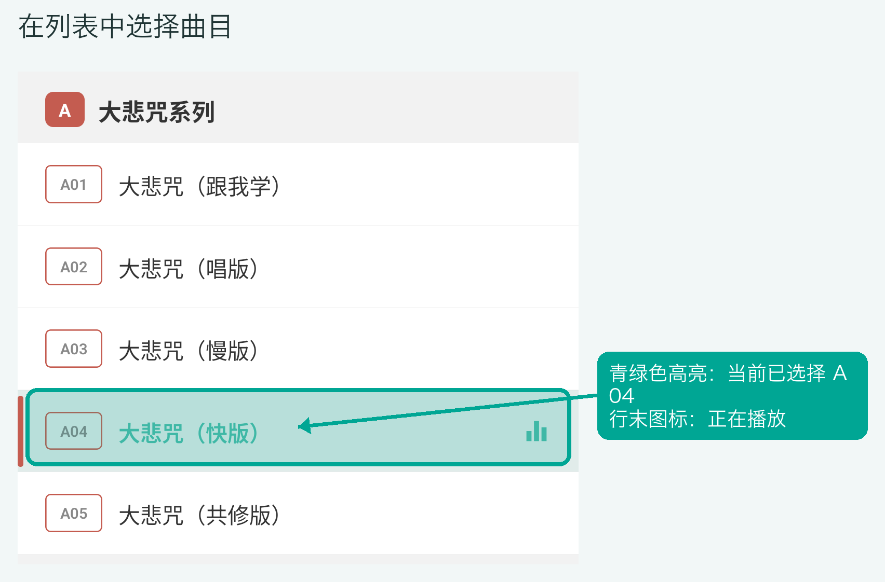

完整曲目列表分为“大悲咒系列”“仪轨回向”“佛号圣号”“经典歌曲”四组。

## 3. 快速开始

### 普通个人播放

1. 点击底部“播放”，进入播放页。

   

2. 查看最右侧同步按钮。如果是绿色双人图标，点击一次，直到显示灰色单人图标，表示同步播放已关闭。

   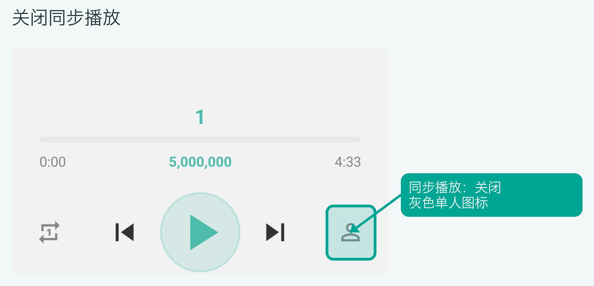

3. 打开“列表”，点击想听的曲目。曲目会立即开始播放，并创建新的播放任务。

   

4. 打开“我的”，选择每首重复遍数。可以使用四个快捷值，也可以选择“自定义”。

   

5. 回到“播放”，点击最左侧按钮选择播放模式。本例中的图标表示“单曲播放”。

   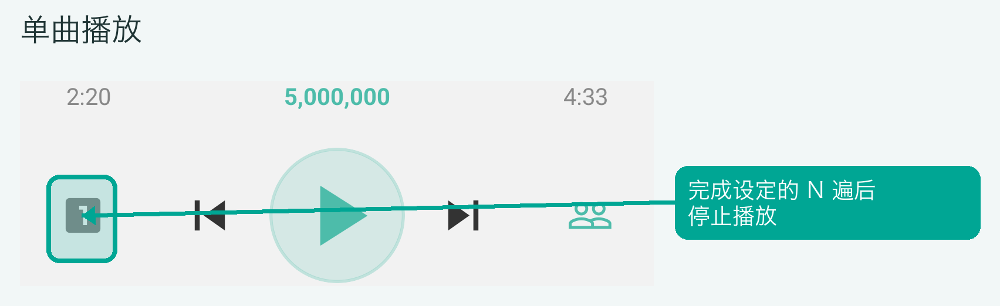

### 多台设备同步播放

1. 在每台设备的系统设置中开启“自动设置日期与时间”和“自动设置时区”。所有设备应使用相同时区。

   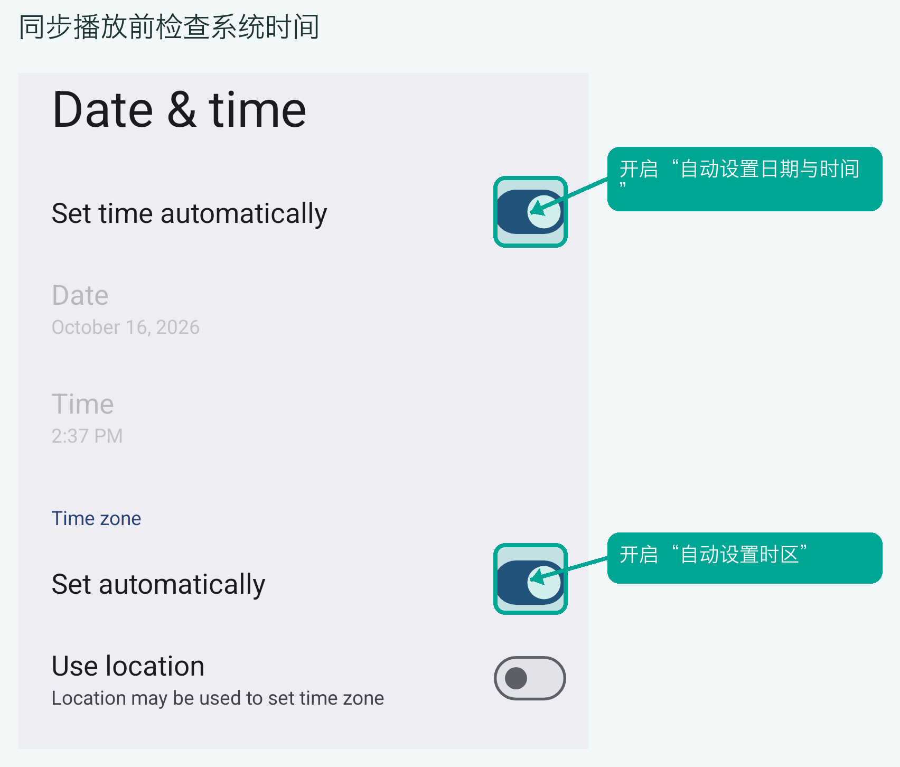

2. 查看最右侧同步按钮。如果是灰色单人图标，点击一次，直到显示绿色双人图标；如果已经是绿色，请保持不变。

   

3. 在所有设备的“列表”中选择同一首曲目。选曲后会立即按当前时间对齐并开始播放。

   

4. 检查中央播放按钮。显示播放三角时，当前设备仍暂停，可以点击一次：

   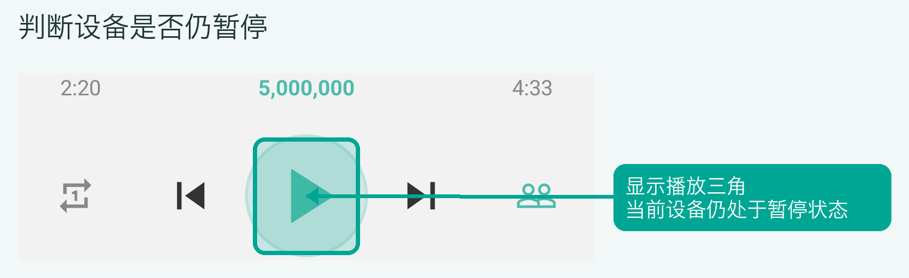

   显示暂停符号时，设备已经播放，不要再次点击，以免变成暂停：

   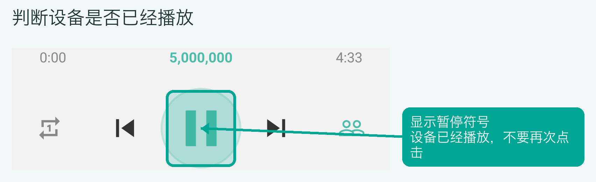

同步使用设备本地时间，不连接服务器。设备时钟、时区、蓝牙设备和扬声器自身延迟都可能造成听感偏差。上面的截图只说明设置方法，不把模拟器截图当作多台真机同步精度的测试证据。

## 4. 播放页的五个按钮

竖屏时，五个按钮从左到右排列；方屏和横屏时，它们在左侧从上到下排列，顺序不变。

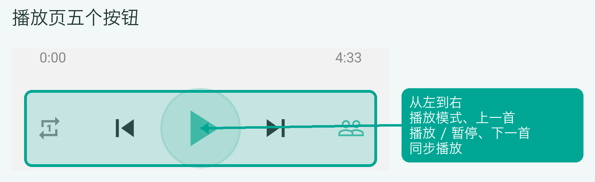

| 顺序 | 按钮      | 作用                                             |
| ---: | --------- | ------------------------------------------------ |
|    1 | 播放模式  | 在单曲循环、单曲播放、列表循环、列表播放之间切换 |
|    2 | 上一首    | 切换到上一首，并创建新的播放任务                 |
|    3 | 播放/暂停 | 开始或暂停当前曲目                               |
|    4 | 下一首    | 切换到下一首，并创建新的播放任务                 |
|    5 | 同步播放  | 灰色单人图标为关闭，绿色双人图标为开启           |

### 切换播放模式

连续点击最左侧按钮时，模式按下面的顺序循环：

`单曲循环 → 单曲播放 → 列表循环 → 列表播放 → 单曲循环`

单曲循环：

单曲播放：

列表循环：

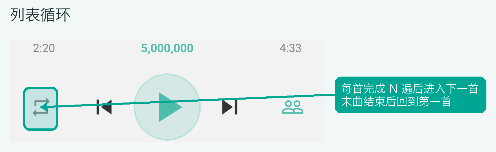

列表播放：

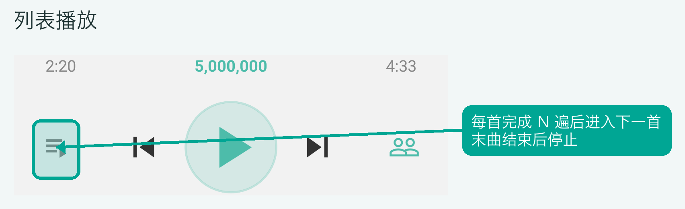

点击模式按钮后，页面顶部还会短暂显示当前模式名称。

### 调整播放进度

普通模式且同步播放关闭时，可以拖动进度条圆点：

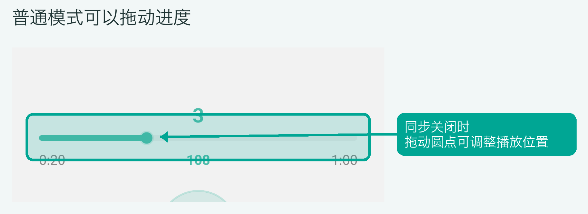

同步播放开启时，进度条锁定，以免手动拖动破坏时间对齐：

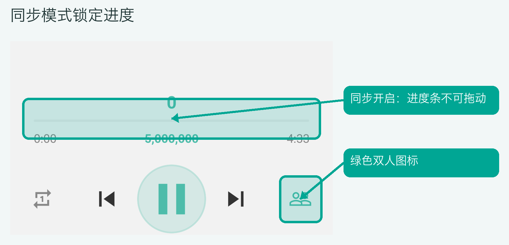

关怀模式下进度条同样锁定。

## 5. 四种播放模式与重复遍数

最重要的规则是：**每首重复遍数始终优先于播放模式。**

| 播放模式 | 当前曲目完成设定的 N 遍后            |
| -------- | ------------------------------------ |
| 单曲播放 | 停止播放                             |
| 单曲循环 | 继续播放当前曲目                     |
| 列表播放 | 进入下一首；最后一首完成后停止       |
| 列表循环 | 进入下一首；最后一首完成后回到第一首 |

例如，把每首重复遍数设为 7，并选择列表播放时，每一首都要完成 7 个有效完整周期，才会进入下一首。四种模式的图标和行为见[切换播放模式](#切换播放模式)。

### 设置每首重复遍数

1. 进入“我的”，直接选择 `1`、`108`、`1,000` 或 `10,000`；需要其他数值时点击“自定义”。

   

2. 输入大于 0 的整数，例如 `5,000,000`，检查数字后点击“确定”。

   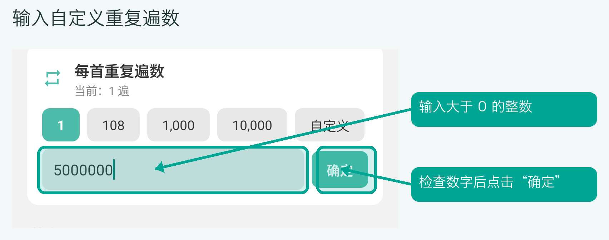

3. 保存后，页面会使用千分位逗号显示大数字。

   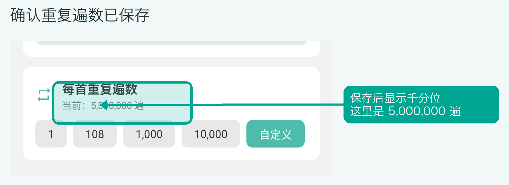

4. 输入 0 时会看到“请输入大于 0 的整数”，数值不会保存。

   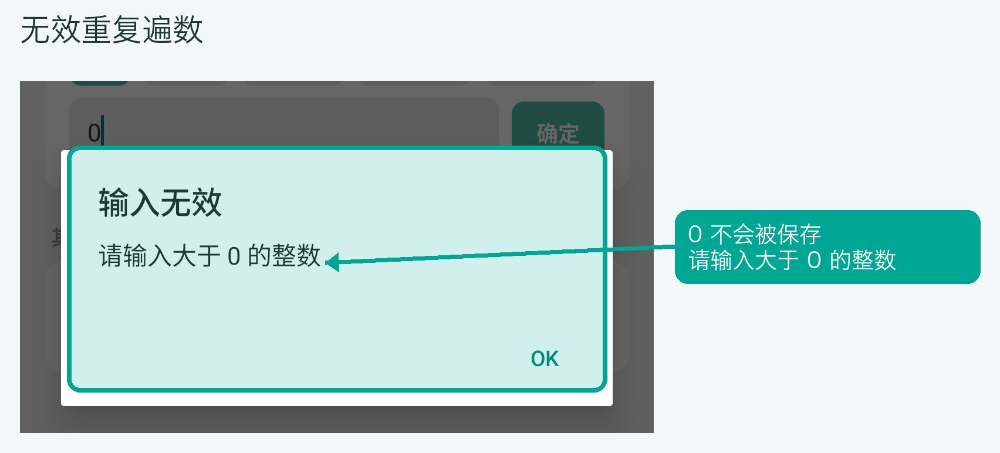

App 没有产品层面的固定小上限，但输入值必须是 JavaScript 可安全表示的整数；空值、0 或极端超大数值会被拒绝。当前输入框会自动删除非数字字符，因此粘贴 `-5` 或 `1.5` 会分别变成 `5` 或 `15`；点击“确定”前请检查转换后的数字。

### 什么算一个有效完整周期

从曲目开头附近（0～1.5 秒）开始，并自然播放到结尾，计为一遍：

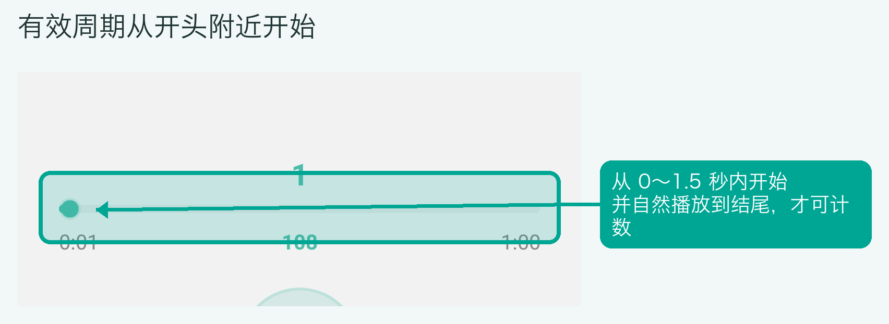

手动跳到中间再播放到结尾，当前尾段不计数。手动拖回开头 1.5 秒以内，再完整播放到结尾，可以重新取得计数资格：

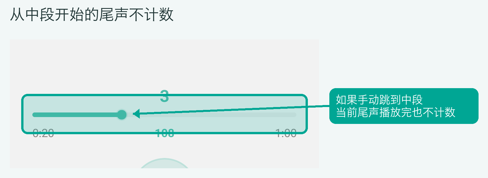

同步模式从曲目中间加入时，先听到的尾段不计数。如果这是尚无已完成遍数的新任务，页面显示第 0 遍；已有任务则保留原累计数：

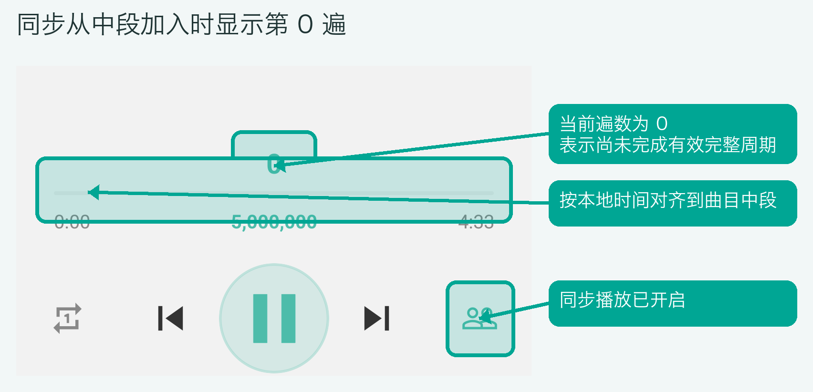

这些图片用于说明界面中的可见状态。单张截图不能证明此前是否发生过拖动或已经完成整个播放周期，计数规则以上面的文字为准。

## 6. 当前遍数如何显示

页面只显示数字，不附加“当前遍数”“每首重复遍数”等文字。较大的数字是当前遍数，较小的数字是设置的每首重复遍数：

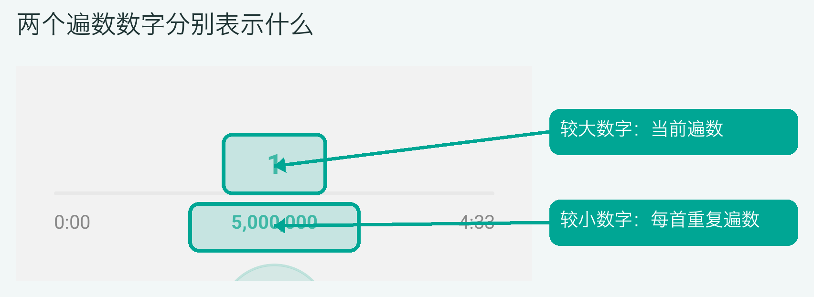

| 条件                                 | 当前遍数 | 每首重复遍数 |
| ------------------------------------ | :------: | :----------: |
| 每首重复遍数大于 1                   |   显示   |     显示     |
| 每首重复遍数等于 1，且为单曲循环     |   显示   |     隐藏     |
| 每首重复遍数等于 1，且为其他三种模式 |   隐藏   |     隐藏     |
| 关怀模式                             |   隐藏   |     隐藏     |

重复遍数为 1 且为单曲循环时，只显示当前遍数：

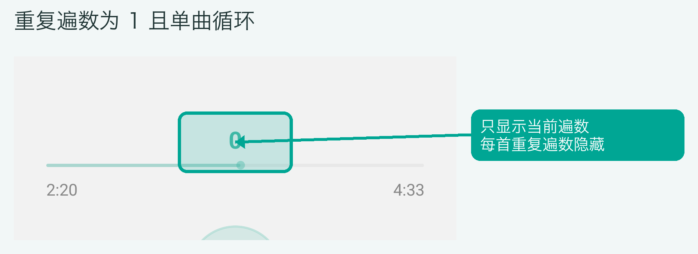

重复遍数为 1 且为其他三种模式时，两项数字都不显示：

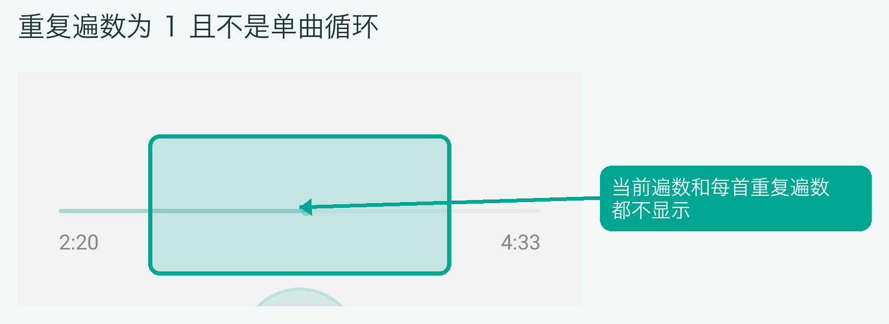

竖屏时，当前遍数在进度条上方，总遍数在进度条下方并与左右时间居中对齐。方屏和横屏时，两项数字位于右侧竖向进度条的左边。

单曲循环会持续开始下一轮 N 遍，因此显示的当前遍数记录整个播放任务的累计结果，可能大于设置值。这是正常设计。

## 7. 遍数保存与清零

每完成一个有效周期，App 会立即保存已完成遍数。关闭 App 前正在第 4 遍时，页面如下：

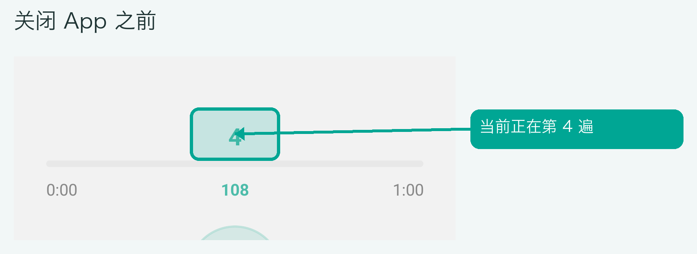

重新打开 App 后仍显示第 4 遍，表示已经完成的遍数得到保留：

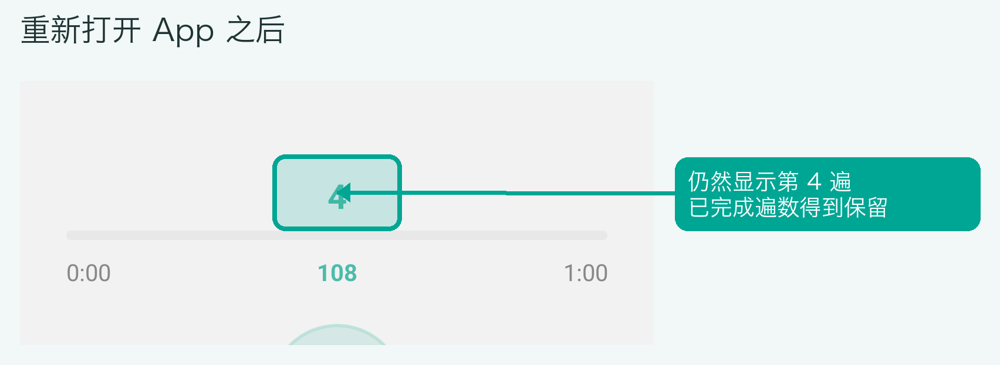

以下操作保留已完成遍数：

- 暂停后继续；
- 切到后台再返回；
- 关闭 App 后重新打开；
- 旋转屏幕或改变 iPad 分屏尺寸。

以下操作视为新的播放任务，并把遍数清零：

- 在“列表”中手动选择任何曲目，包括再次选择当前曲目；
- 点击上一首或下一首；
- 列表播放或列表循环完成当前曲目后，自动进入下一首；
- 单曲播放完成并停止后，再次点击播放。

新任务显示 `1`，表示正在新的第 1 遍；此时已完成遍数已经清零，并不是已经完成 1 遍：

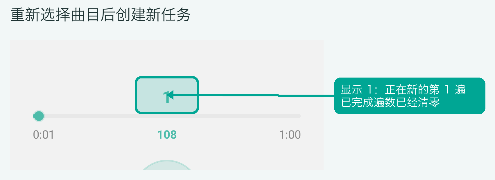

只保存已经完整完成的有效遍数。退出时尚未播完的一遍不会提前计入。

## 8. 同步播放详解

同步按钮有两个状态。灰色单人图标表示关闭：

绿色双人图标表示开启：

同步位置按下面的规则计算：

`从设备本地当天 00:00 到当前时刻的时长，对当前曲目时长取余`

因此，同一时区、时间准确的设备选择同一首曲目后，会计算出相同的播放位置。App 会在以下时机重新对齐：

- 开启同步播放；
- 同步模式下点击播放，或暂停后恢复；
- 每次自然播放到结尾后；
- 可恢复的音频中断或异常恢复后；
- 列表模式进入下一首时。

### 为什么有时显示第 0 遍

如果一个尚未完成过有效周期的新任务从曲目中间加入同步，当前周期的开头并没有在这台设备上完整播放，所以页面显示第 0 遍：

自然到达结尾并进入下一个从开头附近开始的完整周期后，才进入第 1 遍。如果是在已有累计遍数的任务中恢复同步，页面保留原累计数，但这段不完整的尾段仍不会增加计数。

同步播放不会改变“N 遍优先于四种播放模式”的规则。它对齐的是播放时间轴，不承诺专业音频设备级的采样同步。

## 9. 关怀模式

建议先选好曲目、播放模式和重复遍数，再进入“我的”点击“切换到关怀模式”：

关怀模式会：

- 放大文字和播放/暂停按钮；
- 播放页的控制按钮只保留播放/暂停，曲名、唱片和进度仍会显示；
- 隐藏“列表”入口、上下首、模式切换和同步开关；
- 隐藏遍数、重复遍数设置和诊断信息；
- 禁止 App 内和锁屏界面拖动进度；
- 将锁屏远程控制简化为播放/暂停。

关怀模式播放页会圈出锁定的进度条和放大的播放/暂停按钮：

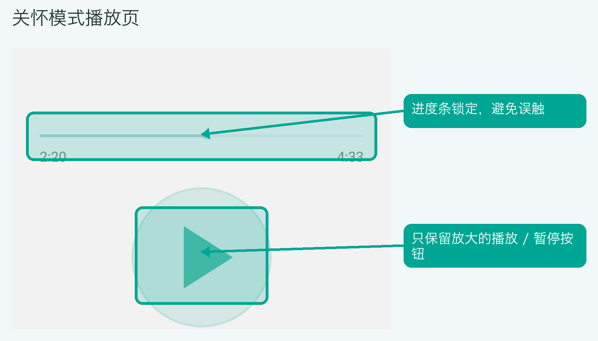

需要恢复完整功能时，进入“我的”点击“切换到普通模式”：

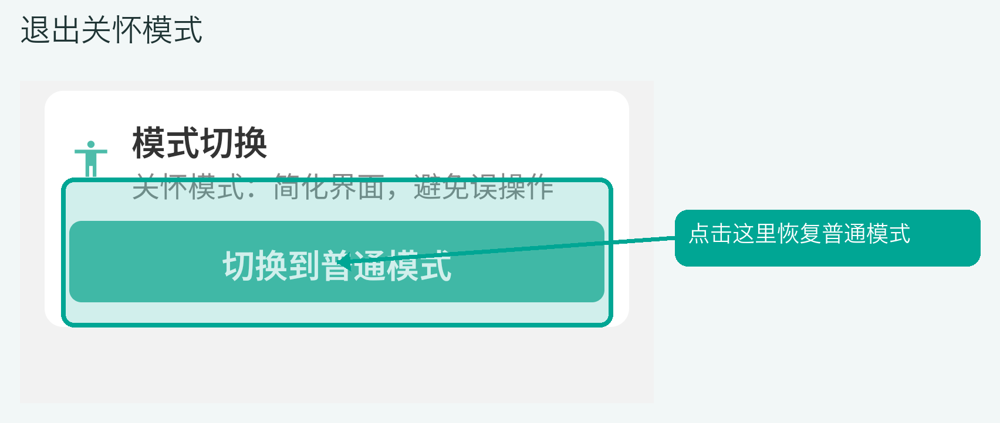

开启或退出关怀模式不会删除之前选择的曲目和设置。

关怀模式的目标是简化界面、放大核心按钮和减少误操作，**不等同于已经完成全部 VoiceOver、TalkBack、动态字体或高对比度无障碍适配**。

## 10. 横屏、方屏和 iPad

同一个安装包会根据当前窗口自动布局，不需要另装横屏版或 iPad 版：

- 竖屏：曲名和唱片居中，横向进度条，底部五按钮一行；
- 方屏（含 iPad 常见的 4:3 横屏）：左侧竖排控制、中间唱片、右侧遍数和竖向进度条；
- 宽横屏：沿用三栏结构，并增加栏间留白。

### iPhone 竖屏

当前遍数位于进度条上方，每首重复遍数位于进度条下方，五个按钮横向排列：

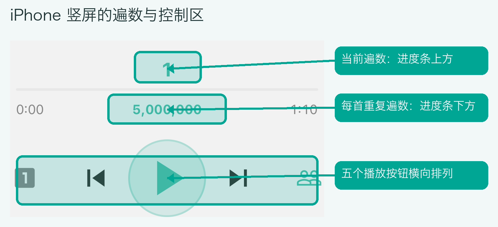

### iPad 竖屏

iPad 竖屏保持相同的信息顺序，并根据窗口大小调整元素尺寸和留白：

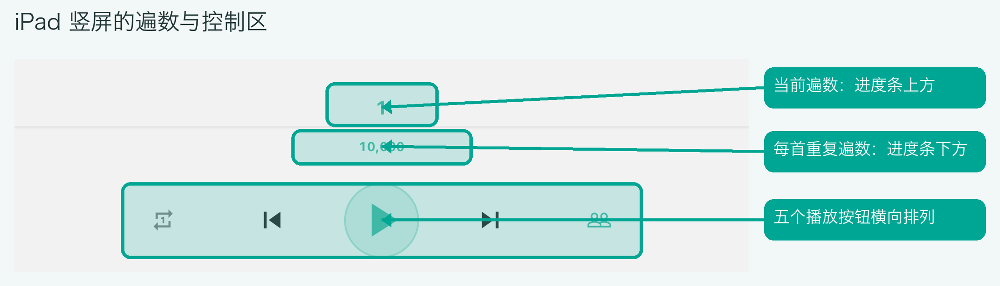

### iPhone 宽横屏

五个按钮位于左侧，中间显示曲名与唱片，右侧显示遍数和竖向进度条。最左侧黑色竖条是设备的灵动岛或屏幕开孔，不是 App 按钮：

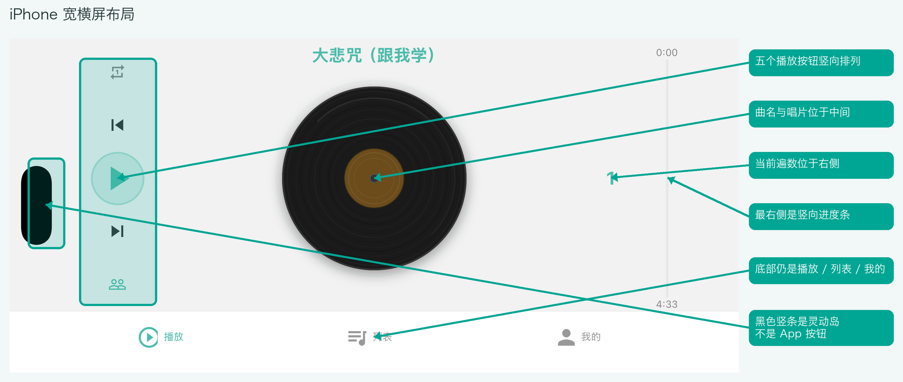

### iPad 方屏或横屏

iPad 常见的 4:3 横屏使用方屏三栏布局。播放按钮中心、唱片圆心和遍数组中心处于同一水平轴：

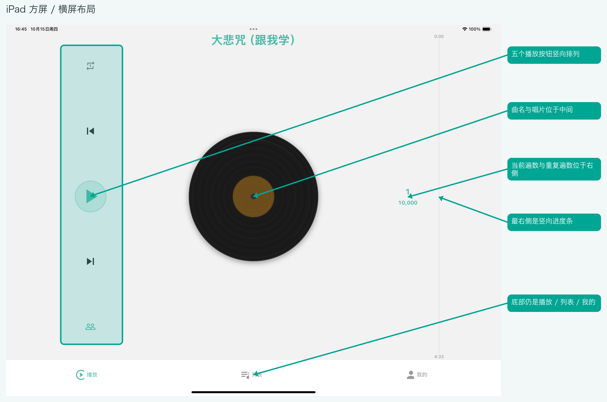

旋转屏幕或调整 iPad 分屏，只会重排界面，不会换曲、跳转进度或清零遍数。

## 11. 后台、通知与锁屏播放

先在 App 内开始播放，返回桌面或锁定屏幕后，音频可以继续播放。

Android 13 及以上首次请求通知权限时，选择“Allow/允许”，才能正常显示播放通知：

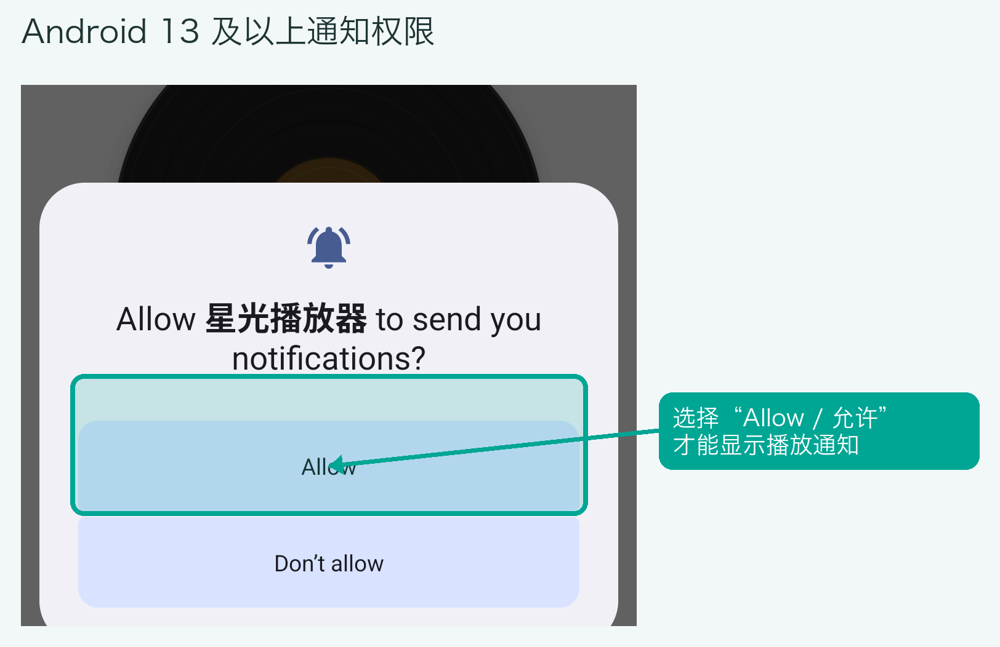

普通模式的 Android 播放通知可显示播放、暂停、上一首、下一首和停止等控制：

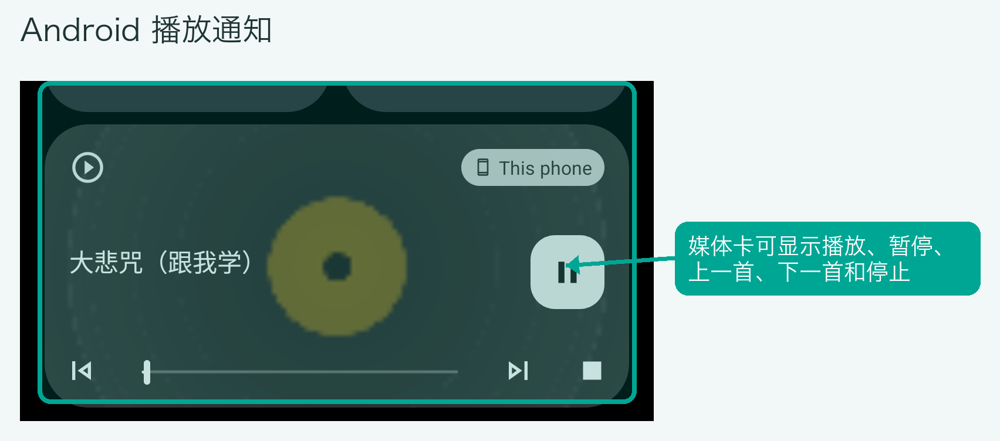

同步模式仍可播放、暂停和切歌，但不提供远程进度调整：

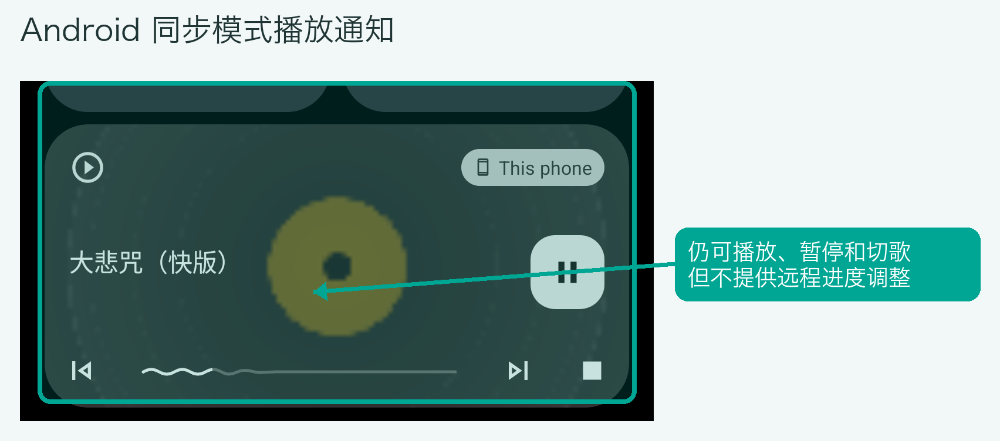

普通模式的锁屏媒体卡会提供系统允许显示的完整媒体控制：

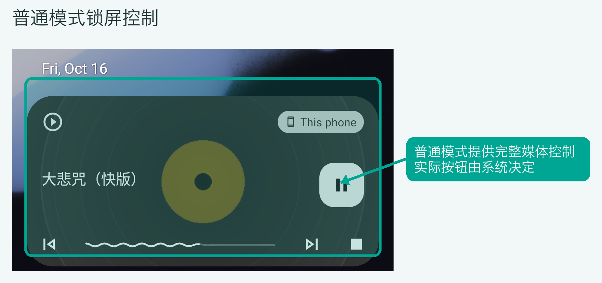

关怀模式的锁屏控制只保留播放/暂停：

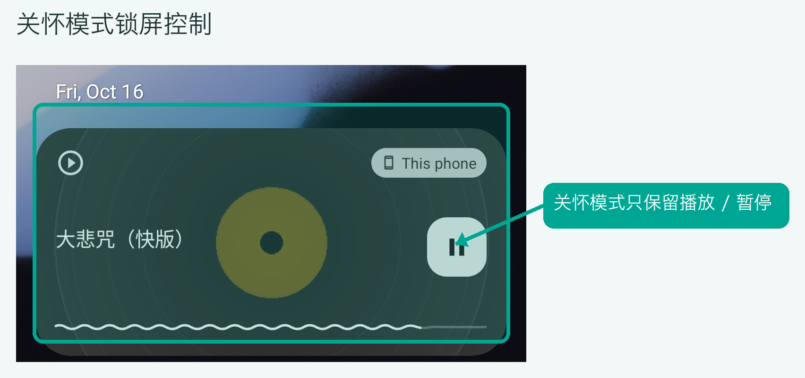

锁屏、控制中心或播放通知中的按钮由当前模式和系统可用空间共同决定：

- 普通模式、同步关闭：可提供播放/暂停、上一首、下一首、停止和进度调整；
- 同步模式：不提供进度调整命令；
- 关怀模式：只提供播放/暂停；
- 系统界面空间较小时，可能只显示部分按钮。

系统可能仍绘制一条进度外观，但是否能拖动取决于 App 提供的远程能力。同步模式和关怀模式不提供远程 Seek。

部分 Android 厂商的省电策略仍可能限制后台播放，可在系统设置中允许通知、后台运行和自启动。iOS 用户主动从多任务界面强制退出 App 后，系统会停止后台音频。

本节图片只说明系统控件的可见布局。Simulator/Emulator 不能替代真机后台保活、来电中断、蓝牙耳机和厂商省电策略测试。

## 12. 导出诊断信息

发生播放、计数或后台异常时，请先保留现场，再按下面的步骤导出诊断文件。

1. 确认当前处于普通模式，进入“我的”，点击“诊断信息”展开。

   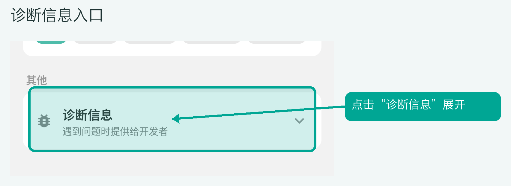

2. 展开后可以查看设备信息和最近的运行日志。

   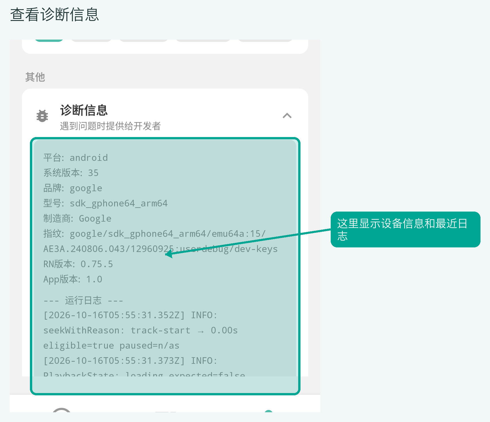

3. 点击页面下方的“导出诊断文件”。

   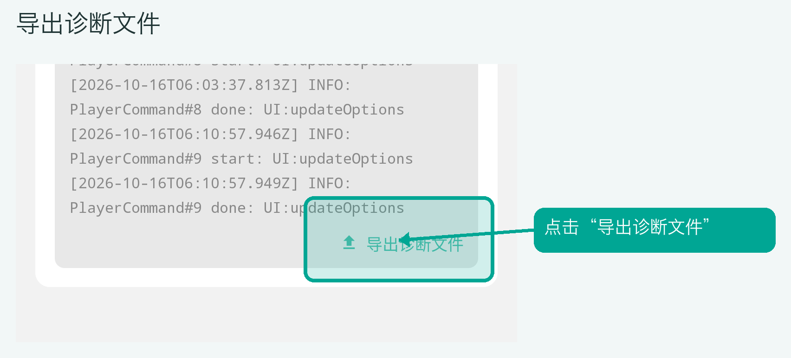

4. 在系统分享面板中选择保存位置、邮件或其他发送方式。

   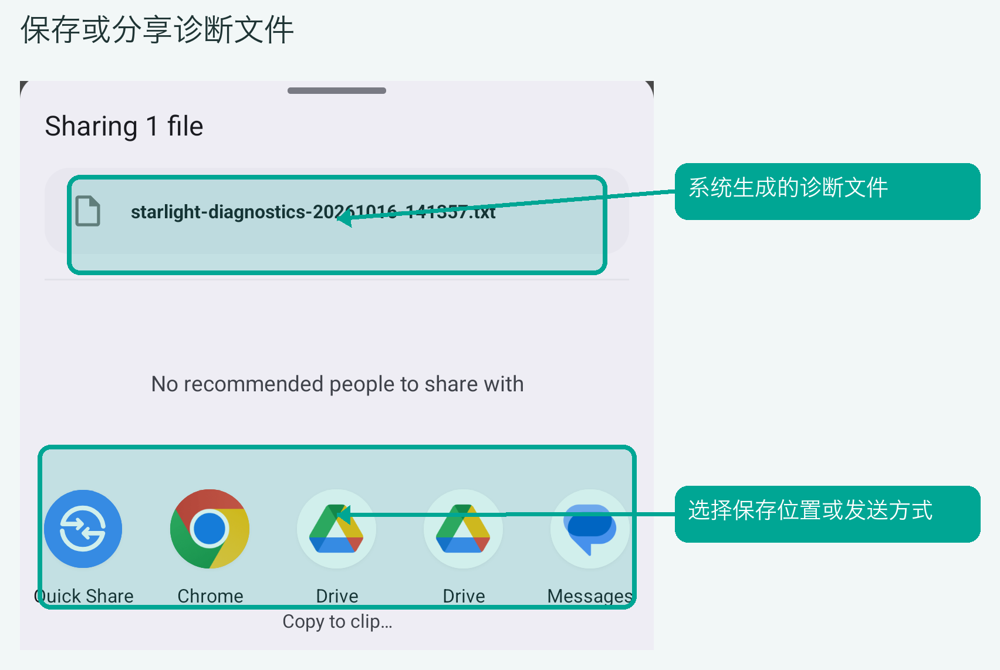

诊断文件名类似 `starlight-diagnostics-20261016-103000.txt`，包含设备系统信息、App 版本和播放日志。页面只展示最近 30 条日志；导出文件包含设备中当前保留的全部日志，最多 1,000 条。

App 不会自动上传文件，只有用户主动选择分享目标时，文件才会离开设备。发送前可以先检查文件内容。

## 13. 常见问题

### 为什么曲目不是从开头播放？

通常是因为同步播放已开启。按[普通个人播放](#普通个人播放)的步骤先关闭同步，再到“列表”重新选择曲目，即可从头开始新的播放任务。

### 为什么当前遍数显示 0？

这是一个尚无已完成遍数的新任务从中间加入同步，尚未完成可计数的完整周期。参见[为什么有时显示第 0 遍](#为什么有时显示第-0-遍)中的圈注图。

### 为什么当前遍数超过设置值？

单曲循环会在完成一轮 N 遍后继续，页面显示的是整个播放任务的累计遍数。参见[当前遍数如何显示](#6-当前遍数如何显示)。

### 为什么进度条不能拖动？

同步播放或关怀模式正在生效。参见[调整播放进度](#调整播放进度)中的可拖动与锁定对照图，关闭相应模式后才能手动调整进度。

### 为什么重新点击同一首曲目后遍数清零？

手动重新选择当前曲目被定义为新的播放任务。参见[遍数保存与清零](#7-遍数保存与清零)。

### 关闭 App 会不会丢失遍数？

已经完成的有效遍数会保存；尚未播完的一遍不会提前计入。卸载 App 会删除所有本地数据。

### 是否需要网络？

不需要。21 首音频均内置，播放和同步算法都可以离线工作。

### 多台设备仍听起来有少量先后差异怎么办？

先按[多台设备同步播放](#多台设备同步播放)检查自动时间、时区、同步开关和曲目；再排除蓝牙耳机、蓝牙音箱或不同扬声器本身的输出延迟。

### 如何报告播放问题？

问题发生后不要立即卸载或清除 App 数据。先按[导出诊断信息](#12-导出诊断信息)的图示导出文件，并附上设备型号、系统版本、曲目、播放模式、重复遍数和问题发生时间。

## 14. 隐私

设置、曲目状态、已完成遍数、按本地日期保存的播放统计和诊断日志只保存在设备本地。App 不接入广告、分析或追踪服务。完整说明见[隐私政策](../PRIVACY.md)。
